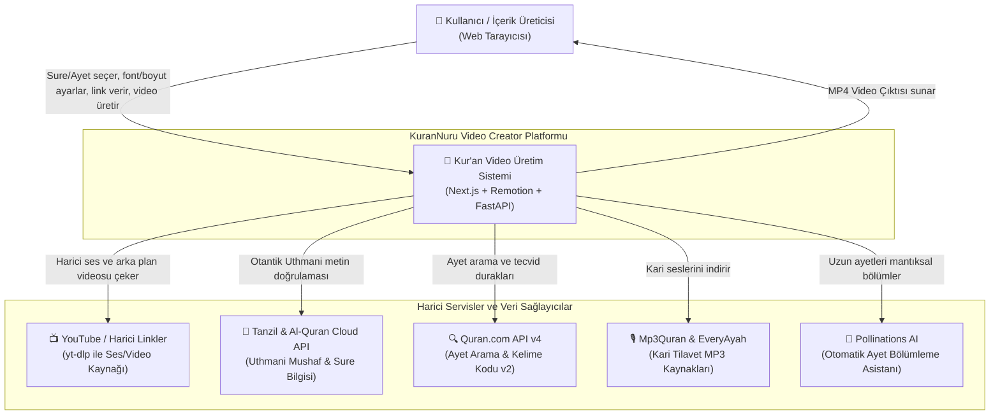
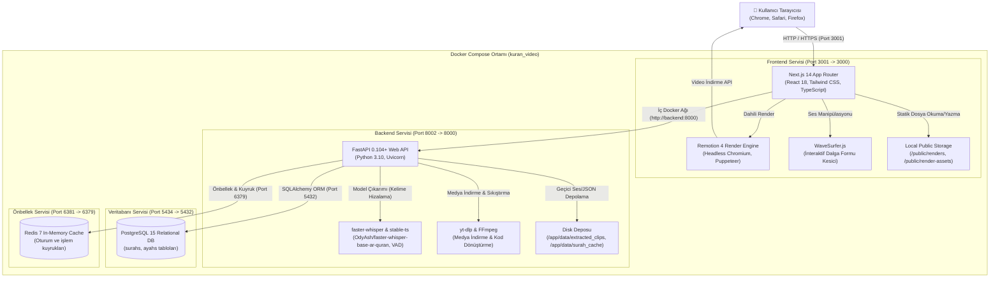
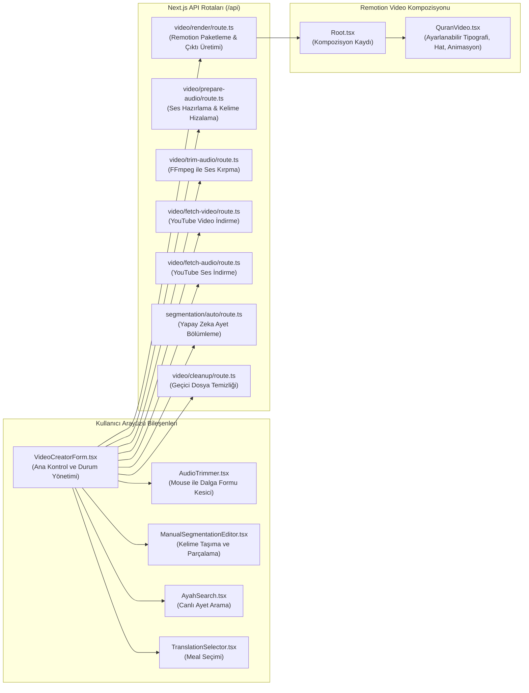
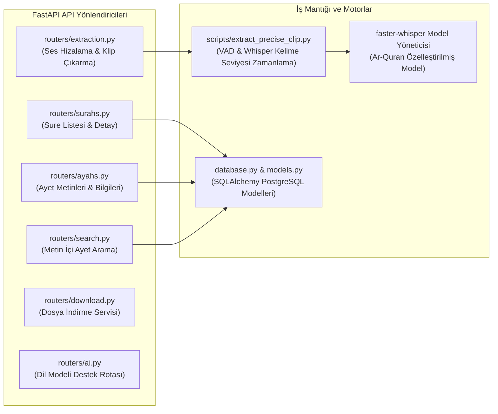
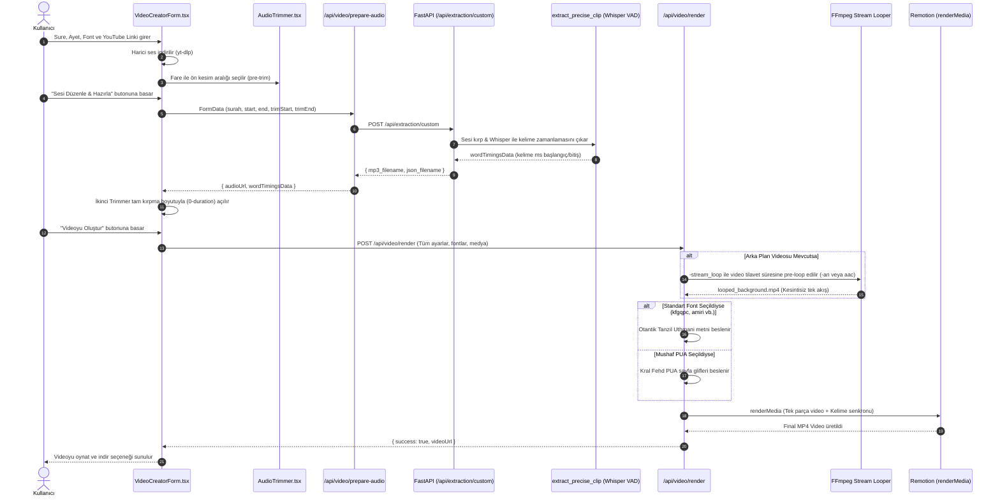

# Kur'an Video Projesi — C4 Mimari Modeli

Bu doküman, KuranNuru Video Creator (`kuran-video`) projesinin yazılım mimarisini C4 modelleme standardına uygun olarak tanımlar.

---

## C1 — Sistem Bağlamı (System Context)

Sistem bağlamı, sistemin dış dünyadaki aktörlerle (kullanıcılar) ve harici üçüncü parti servislerle olan ilişkilerini üst seviyeden gösterir.

---

## C2 — Konteyner Mimarisi (Container Diagram)

Sistemi oluşturan bağımsız çalışma birimlerini (Docker konteynerleri, veri depoları ve protokoller) tanımlar.

---

## C3 — Bileşen Seviyesi (Component Diagram)

### Frontend Bileşenleri (`kuran-video/frontend`)

### Backend Bileşenleri (`kuran-video/backend`)

---

## C4 — Kod ve Çalışma Akışı Seviyesi (Code / Pipeline Flow)

Kur'an Video Üretim Hattının (Video Creation & Alignment Pipeline) uçtan uca yürütme sıralaması:

